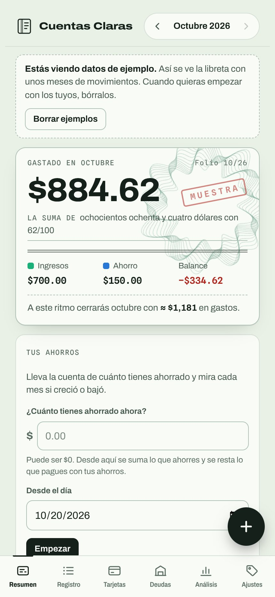
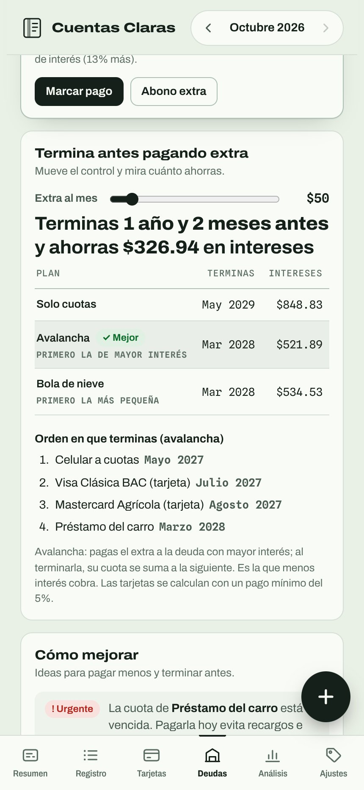
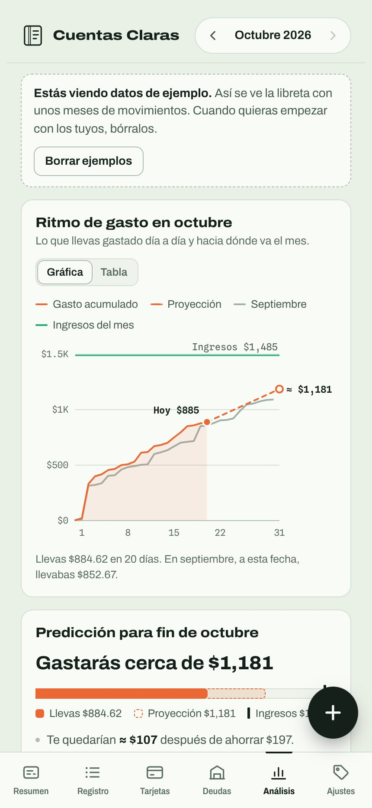
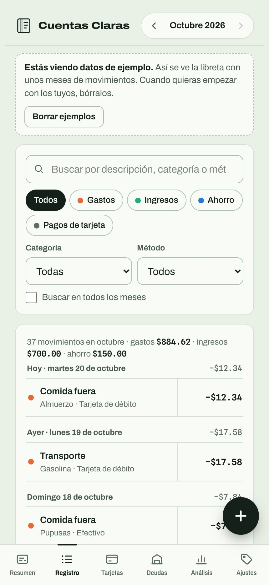
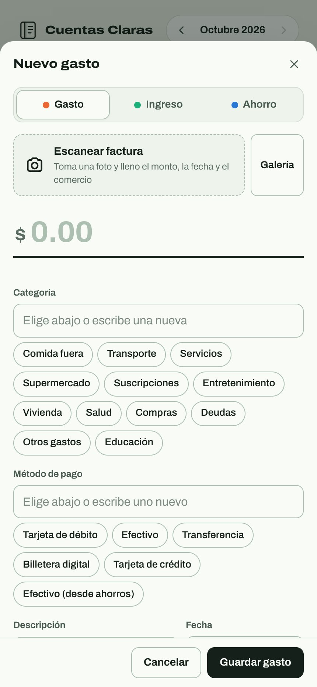
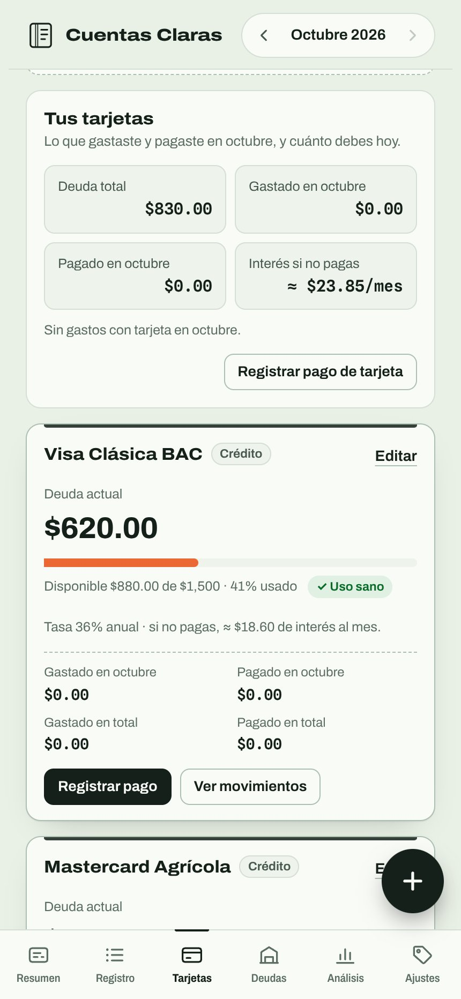
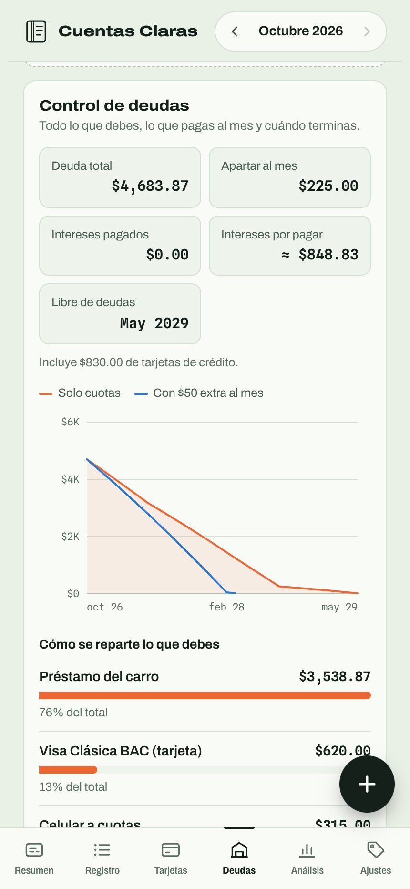
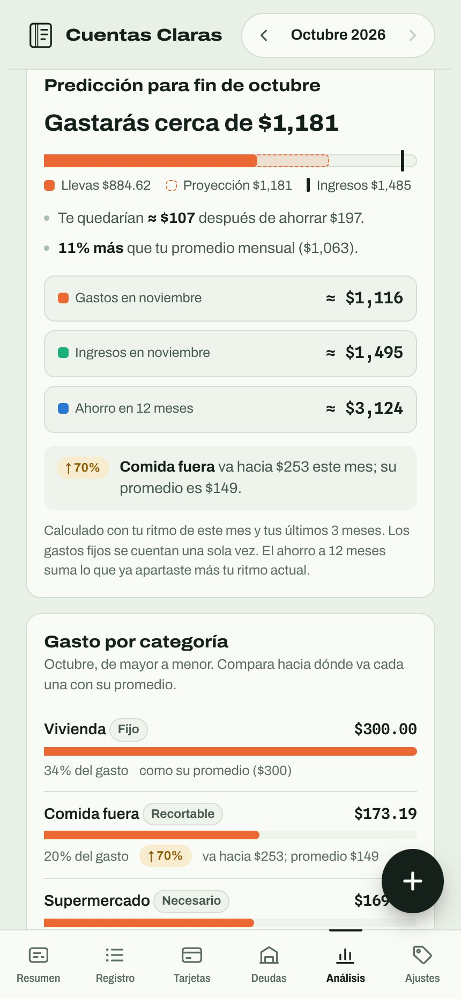

# Cuentas Claras

<p align="center"><b>English</b> · <a href="README.es.md">Español</a></p>

**A personal finance app for tracking spending, income, savings, credit cards and debts, in one place.** It installs on your phone like a native app, works offline, and keeps your data on your device: no account, no server, no ads.

🔗 **Live app:** [cuentas-two-rust.vercel.app](https://cuentas-two-rust.vercel.app) (tap "Ver con datos de ejemplo" to explore it with sample data)

The interface is in Spanish.

<p align="center">
  
  
  
</p>

## What it does

- **Monthly summary**: how much you've spent, earned and saved this month, written out like a check, plus a projection of where the month will close at your current pace.
- **Transaction log** with search and filters by type, category and payment method, across the current month or all months.
- **Receipt scanning**: take a photo of a receipt and the app reads the amount, date and store. OCR runs **inside the browser**, so the photo never leaves your phone.
- **Savings tracking**: starting balance and month-over-month change.
- **Credit cards**: current debt, credit usage, interest you'd pay if you don't pay it off, and spending and payments per card.
- **Debts and installments**: loans and buy-now-pay-later purchases with monthly payment, remaining balance and interest, and a payoff date.
- **Payoff planner**: a slider for extra monthly payments shows how much sooner you'd finish and how much interest you'd save, comparing the **avalanche** method (highest interest first) with the **snowball** method (smallest balance first).
- **Analysis**: spending pace for the month against last month, an end-of-month forecast based on your last three months, and spending by category with alerts when a category is running above its average.
- **Categories with monthly limits**, CSV export, and light and dark themes.

## Screenshots

| | | |
|:---:|:---:|:---:|
| <br>**Transaction log** | <br>**New expense** with receipt scanning | <br>**Credit cards** |
| <br>**Debt overview** and payoff chart | <br>**End-of-month forecast** | |

## How it's built

A single-page **Progressive Web App** written in plain HTML, CSS and JavaScript, with no framework and no build step.

| Area | How |
| --- | --- |
| Offline and install | Service Worker caches the app shell; Web App Manifest with maskable icons so it installs on Android and iOS |
| Storage | Data stays on the device in `localStorage`, with IndexedDB for receipt photos |
| Receipt OCR | [Tesseract.js](https://tesseract.projectnaptha.com/), loaded on demand and run locally in the browser |
| Charts | Hand-written SVG |
| Theming | CSS custom properties with automatic light/dark mode |
| Hosting | Static files on Vercel |

Because there's no backend, there's nothing to sign up for and nothing to leak: everything you enter stays in your browser. Export to CSV whenever you want a copy.

## Running it locally

There's nothing to install. Serve the folder with any static server:

```bash
git clone https://github.com/js3rr4n0/Cuentas.git
cd Cuentas
python3 -m http.server 8000
```

Open [http://localhost:8000](http://localhost:8000). Service Workers need `localhost` or HTTPS, so opening `index.html` directly from disk won't enable offline mode.

---

Built by **Julio César Serrano Sandoval** · [LinkedIn](https://www.linkedin.com/in/julioserrasand/)
